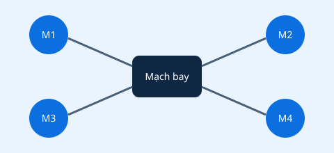

## Chuẩn bị

Đoạn mở đầu nói rõ người đọc sẽ làm được gì sau bài này.

::youtube{id=dQw4w9WgXcQ}

::product{slug=dv-code-fleet}

:::warning
Tháo cánh quạt trước khi cắm pin để kiểm tra động cơ.
:::

::file{src=./so-do-dau-day.svg label="Tải sơ đồ đấu dây"}
