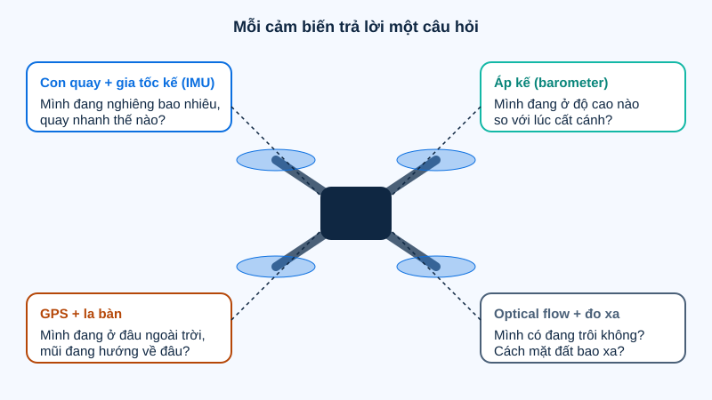

Một chiếc drone tự giữ thăng bằng, giữ độ cao và quay về điểm xuất phát là nhờ một nhóm cảm biến làm việc cùng nhau. Bài này giới thiệu từng loại, điểm mạnh, điểm yếu và cách mạch bay kết hợp chúng.

## IMU: con quay và gia tốc kế

IMU (Inertial Measurement Unit, khối đo quán tính) là cảm biến quan trọng nhất. Không có nó, drone không bay được.

- **Con quay (gyroscope)** đo tốc độ quay quanh ba trục. Phản ứng rất nhanh, nhưng nếu cộng dồn để tính góc thì sai số tích lũy dần (gọi là trôi, drift).
- **Gia tốc kế (accelerometer)** đo gia tốc, trong đó có gia tốc trọng trường. Khi drone đứng yên, nó cho biết đâu là phía "dưới", nên tính được góc nghiêng; nhưng rung động của động cơ làm số đo rất nhiễu.

Mạch bay kết hợp hai cảm biến: tin con quay trong thời gian ngắn, dùng gia tốc kế để sửa trôi trong thời gian dài. Đây là ý tưởng của **bộ lọc bù (complementary filter)** và, phức tạp hơn, **bộ lọc Kalman**.

## Áp kế: đo độ cao bằng áp suất

Áp suất không khí giảm khi lên cao. Áp kế (barometer) đo áp suất để suy ra độ cao **tương đối** so với lúc cất cánh. Nó nhạy với gió và luồng khí từ chính cánh quạt, nên nhiều drone đặt áp kế trong một lớp mút xốp.

## GPS và la bàn

- **GPS** cho vị trí ngoài trời. Với thiết bị dân dụng, sai số thường vài mét, và GPS gần như không dùng được trong nhà.
- **La bàn (magnetometer)** cho biết mũi drone hướng về đâu. Nó dễ bị nhiễu bởi dây điện mang dòng lớn, kết cấu sắt thép, nên cần hiệu chỉnh và đặt xa dây nguồn.

GPS và la bàn cho phép drone **giữ vị trí** khi có gió và **tự quay về** điểm cất cánh.

## Optical flow và cảm biến khoảng cách

Trong nhà không có GPS, drone giáo dục cỡ nhỏ thường dùng:

- **Optical flow:** một camera nhỏ nhìn xuống, theo dõi các họa tiết trên sàn để biết drone có đang trôi ngang không.
- **Cảm biến khoảng cách** (thời gian bay của tia hồng ngoại, siêu âm hoặc LiDAR): đo chính xác độ cao so với mặt sàn ở tầm thấp.

Vì vậy sàn trơn bóng một màu hoặc phòng thiếu sáng làm drone loạng choạng: optical flow không có gì để bám.

## So sánh nhanh

| Cảm biến | Trả lời câu hỏi | Điểm yếu |
|---|---|---|
| Con quay | Đang quay nhanh thế nào? | Trôi khi cộng dồn lâu |
| Gia tốc kế | Phía nào là "dưới"? | Nhiễu do rung |
| Áp kế | Cao hơn lúc cất cánh bao nhiêu? | Nhạy với gió, luồng khí |
| GPS | Đang ở đâu? | Không dùng trong nhà, sai số vài mét |
| La bàn | Mũi hướng về đâu? | Nhiễu từ trường |
| Optical flow | Có đang trôi ngang không? | Cần sàn có họa tiết, đủ sáng |

## Thí nghiệm cho lớp THPT

1. **Đọc IMU bằng vi điều khiển:** nối mô-đun MPU-6050 với Arduino hoặc ESP32, in góc nghiêng tính từ gia tốc kế và từ con quay. Đặt bo mạch nằm yên 5 phút: góc tính từ con quay trôi bao nhiêu?
2. **Bộ lọc bù:** viết công thức `góc = 0,98 × (góc + tốc_độ_quay × dt) + 0,02 × góc_từ_gia_tốc_kế` và so sánh với hai cách trên.
3. **Áp kế và cầu thang:** mang áp kế lên từng tầng, ghi áp suất, tính độ cao mỗi tầng và so với số đo bằng thước.

:::note
Thí nghiệm 1 và 2 không cần drone, chỉ cần mô-đun cảm biến giá rẻ, rất hợp làm dự án nhóm.
:::

Muốn đi xa hơn với camera và trí tuệ nhân tạo, xem bài [Thị giác máy tính trên drone](/r-d/thi-giac-may-tinh-tren-drone).

::product{slug=dv-ai-vision}

## Tham khảo

- Wikipedia: "Inertial measurement unit", "Complementary filter", "Kalman filter".
- Tài liệu ArduPilot và PX4 về cảm biến và bộ ước lượng trạng thái (EKF).

*Ảnh bìa: mô-đun GY-521 (MPU-6050). Nevit Dilmen, CC BY-SA 3.0, Wikimedia Commons.*
