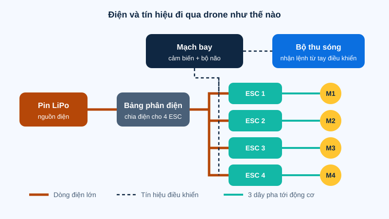
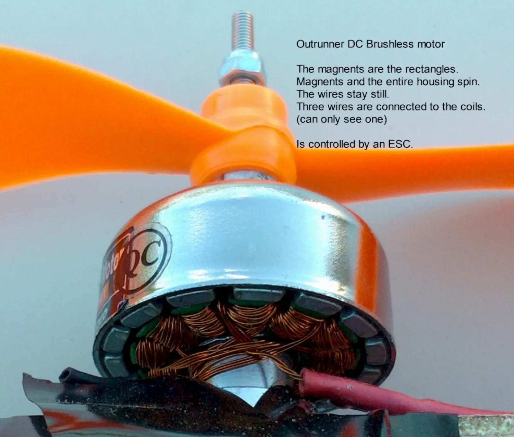
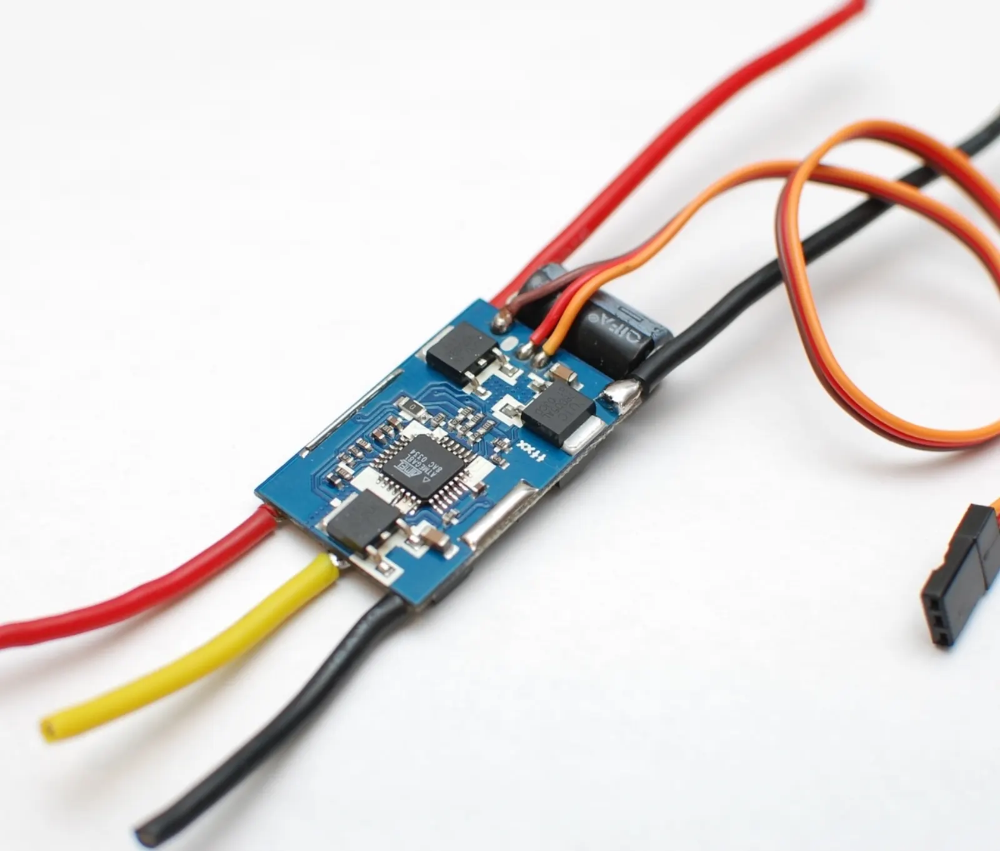

Bài này giới thiệu bảy bộ phận chính của một chiếc drone bốn cánh và cách chúng nối với nhau. Đọc xong, học sinh đọc được thông số trên linh kiện và hiểu vì sao đổi một bộ phận lại ảnh hưởng tới cả chiếc drone.

## Sơ đồ tổng quát

Có hai "dòng chảy" trong drone: **điện** đi từ pin tới động cơ, và **tín hiệu** đi từ tay điều khiển qua mạch bay tới động cơ. Phân biệt được hai dòng này là hiểu được 80% cách drone hoạt động.

## 1. Khung

Khung giữ mọi bộ phận và quyết định kích thước drone. Thông số hay gặp là **chiều dài cơ sở** (wheelbase): khoảng cách giữa hai trục động cơ chéo nhau, tính bằng milimét. Khung cho lớp học nên có **khung bảo vệ cánh quạt** để giảm va chạm.

## 2. Động cơ không chổi than

*Ảnh: 1sfoerster, CC BY-SA 3.0, Wikimedia Commons.*

Drone dùng động cơ không chổi than (brushless) vì bền và hiệu suất cao. Thông số **KV** cho biết số vòng/phút động cơ quay thêm khi tăng 1 vôn, lúc không tải. KV cao quay nhanh, hợp cánh nhỏ; KV thấp quay chậm hơn nhưng khỏe, hợp cánh lớn.

## 3. Cánh quạt

Cánh quạt ghi kiểu `5x4,3`: số đầu là **đường kính**, số sau là **bước** (quãng đường lý thuyết cánh tiến được sau một vòng quay), đơn vị inch. Mỗi drone dùng hai cánh quay thuận và hai cánh quay nghịch (xem bài [Drone bay như thế nào](/r-d/drone-bay-nhu-the-nao)).

## 4. ESC (bộ điều tốc)

*Ảnh: Avsar Aras, CC BY-SA 3.0, Wikimedia Commons.*

ESC nhận tín hiệu từ mạch bay rồi đóng ngắt dòng điện lớn từ pin vào **ba dây pha** của động cơ, theo đúng thứ tự để động cơ quay. Con số như "35A" là dòng điện liên tục tối đa ESC chịu được. Đảo hai trong ba dây pha thì động cơ quay ngược chiều.

## 5. Mạch bay

Mạch bay (flight controller) là "bộ não": một vi điều khiển cùng cảm biến con quay và gia tốc kế. Nó đọc cảm biến, nhận lệnh từ bộ thu sóng và tính tốc độ cho từng động cơ nhiều trăm lần mỗi giây. Phần mềm mạch bay phổ biến gồm Betaflight (drone bay nhanh, FPV), ArduPilot và PX4 (drone tự hành, có GPS). Xem thêm bài [Cảm biến trên drone](/r-d/cam-bien-tren-drone).

## 6. Bộ thu sóng và tay điều khiển

Tay điều khiển gửi lệnh không dây; bộ thu sóng trên drone nhận và chuyển cho mạch bay. Drone giáo dục cỡ nhỏ thường dùng Wi-Fi và điều khiển bằng máy tính bảng hoặc chương trình.

## 7. Pin LiPo

Pin lithium polymer (LiPo) nhẹ và xả dòng lớn. Số **S** là số cell nối tiếp: 1S là 3,7 V, 2S là 7,4 V, 4S là 14,8 V. LiPo cần sạc và cất giữ đúng cách, xem bài [Pin LiPo an toàn trong lớp học](/r-d/pin-lipo-an-toan-lop-hoc).

## Ví dụ: đọc cấu hình một drone

| Bộ phận | Thông số | Đọc là |
|---|---|---|
| Khung | 250 mm | Khoảng cách hai động cơ chéo nhau là 250 mm |
| Động cơ | 2205, 2300KV | Stator rộng 22 mm, cao 5 mm; tăng 1 V thì quay thêm 2.300 vòng/phút |
| Cánh | 5x4,3 | Đường kính 5 inch, bước 4,3 inch |
| ESC | 4 × 30A | Mỗi động cơ chịu tối đa 30 A |
| Pin | 4S 1.500 mAh | 14,8 V, dung lượng 1,5 Ah |

## Lỗi thường gặp khi lắp

- Cắm nhầm thứ tự động cơ vào mạch bay: drone lật ngay khi cất cánh.
- Lắp nhầm cánh thuận và cánh nghịch: drone không nhấc lên được hoặc tự xoay.
- Hàn dây nguồn ngược cực: hỏng ESC hoặc mạch bay. Luôn kiểm tra bằng đồng hồ vạn năng trước khi cắm pin.

:::warning
Luôn tháo cánh quạt khi cấu hình hoặc kiểm tra động cơ trên bàn.
:::

## Gợi ý cho lớp học

Chia nhóm, mỗi nhóm nhận một bộ phận và trình bày "bộ phận này làm gì, nếu hỏng thì drone sẽ ra sao". Sau đó ghép lại thành sơ đồ hoàn chỉnh trên bảng.

::product{slug=dv-code-fleet}

## Tham khảo

- Tài liệu ArduPilot, phần "Choosing a frame" và "ESCs and motors".
- Tài liệu Betaflight, phần cấu hình động cơ.

*Ảnh bìa: Tomwsulcer, CC0, Wikimedia Commons.*
