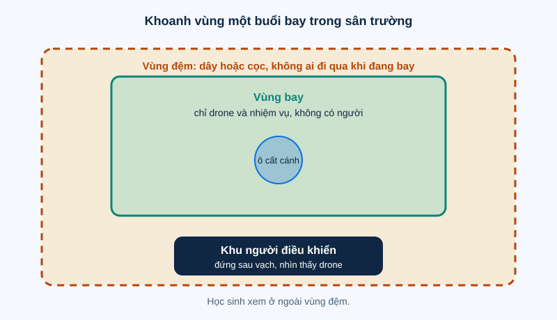

Một buổi bay an toàn được quyết định từ trước khi cánh quạt quay. Đây là danh sách kiểm tra Drone Việt dùng khi tổ chức bay ở trường, chia theo ba giai đoạn để giáo viên in ra và đánh dấu.

## Khoanh vùng trước tiên

- **Vùng bay:** chỉ có drone và nhiệm vụ, không ai đứng trong đó khi cánh quạt quay.
- **Vùng đệm:** dây hoặc cọc quanh vùng bay. Không ai đi qua khi đang bay.
- **Khu người điều khiển:** đứng sau vạch, luôn nhìn thấy drone.
- **Khán giả:** đứng ngoài vùng đệm.

## Trước buổi bay

**Địa điểm và thời tiết**
- [ ] Biết rõ trường có nằm gần sân bay, biên giới, khu quân sự không (xem [Bản đồ khu vực bay](/dao-tao/ban-do)).
- [ ] Bay ngoài trời: trời khô, gió nhẹ, đủ sáng. Gió mạnh đến mức lá cây lớn rung mạnh thì hoãn bay drone nhỏ.
- [ ] Bay trong nhà: dọn đồ treo, quạt trần tắt, sàn có họa tiết, đèn đủ sáng.

**Giấy tờ**
- [ ] Đã kiểm tra quy định về đăng ký drone, giấy phép điều khiển và xin phép bay cho loại drone đang dùng ([Quy định pháp lý](/dao-tao/quy-dinh), [Cấp phép bay](/dao-tao/cap-phep)).
- [ ] Ban giám hiệu và phụ huynh (nếu cần) đã biết lịch bay.

**Thiết bị**
- [ ] Pin đã sạc có giám sát, không phồng, không móp ([Pin LiPo an toàn](/r-d/pin-lipo-an-toan-lop-hoc)).
- [ ] Cánh quạt không nứt, không mẻ, lắp đúng chiều, siết chặt.
- [ ] Khung bảo vệ cánh quạt đã lắp.
- [ ] Tay điều khiển hoặc máy tính bảng đầy pin, kết nối ổn định.
- [ ] Có túi chống cháy, hộp sơ cứu, bình chữa cháy trong tầm với.

**Con người**
- [ ] Phân vai mỗi nhóm: **người điều khiển**, **người quan sát** (nhìn drone và hô "dừng" khi có nguy hiểm), **người giữ an toàn vùng bay**, **người ghi chép**.
- [ ] Phổ biến tín hiệu dừng chung: hô to "Dừng" thì người điều khiển hạ cánh ngay.
- [ ] Tóc dài buộc gọn, không đeo dây, khăn lủng lẳng gần cánh quạt.

## Trong khi bay

- [ ] Cắm pin **sau cùng**, khi mọi người đã ở đúng vị trí.
- [ ] Cất cánh từ ô cất cánh, bay treo 2 đến 3 giây ở độ cao thấp để kiểm tra trước khi làm nhiệm vụ.
- [ ] Luôn giữ drone trong tầm mắt; không bay qua đầu người.
- [ ] Mỗi lúc chỉ một drone trong một vùng bay, trừ khi bài tập được thiết kế cho nhiều drone.
- [ ] Hạ cánh khi báo pin yếu, không cố bay thêm.
- [ ] Drone mất kiểm soát: người điều khiển hạ ga hoặc dùng lệnh dừng khẩn cấp, mọi người tránh xa, **không** chụp drone bằng tay.

## Sau khi bay

- [ ] Rút pin ngay khi cánh quạt dừng hẳn.
- [ ] Để pin nguội trong túi chống cháy, ghi số lần bay vào sổ.
- [ ] Kiểm tra cánh quạt, khung, ốc; ghi lại hư hỏng.
- [ ] Đưa pin về mức cất giữ nếu không dùng trong vài ngày.
- [ ] Ghi sự cố (nếu có): chuyện gì xảy ra, vì sao, lần sau làm gì khác.
- [ ] Thu dọn dây khoanh vùng, kiểm đếm thiết bị.

## Xử lý sự cố thường gặp

| Sự cố | Xử lý |
|---|---|
| Drone va vào người | Dừng buổi bay, sơ cứu vết thương, báo nhà trường, ghi sự cố |
| Cánh quạt gãy giữa chừng | Hạ cánh ngay, thay cả cặp cánh |
| Drone rơi xuống nước | Rút pin ngay khi vớt lên, không cắm pin lại, để khô và kiểm tra |
| Pin phồng hoặc nóng bất thường | Ngừng dùng, đặt vào túi chống cháy ngoài trời, xa người |
| Mất kết nối | Đa số drone giáo dục tự hạ cánh; mọi người tránh xa điểm drone đang hạ |

:::warning
Nếu không chắc một điều kiện nào trong danh sách, hãy hoãn bay. Một buổi bay bị hoãn luôn tốt hơn một tai nạn.
:::

Nhà trường muốn có huấn luyện viên đồng hành trong buổi bay đầu tiên có thể đăng ký [Workshop trải nghiệm drone](/giao-duc/workshop). Học sinh nên tập trước trên [trình bay mô phỏng](/bay-mo-phong).

::product{slug=dv-instructor-kit}

## Tham khảo

- Hướng dẫn an toàn của nhà sản xuất drone và pin đang dùng (luôn ưu tiên).
- Trang [Bay an toàn](/bay-an-toan) của Drone Việt.

*Ảnh bìa: buổi huấn luyện bay drone ngoài trời. BLM Oregon & Washington, phạm vi công cộng, Wikimedia Commons.*
