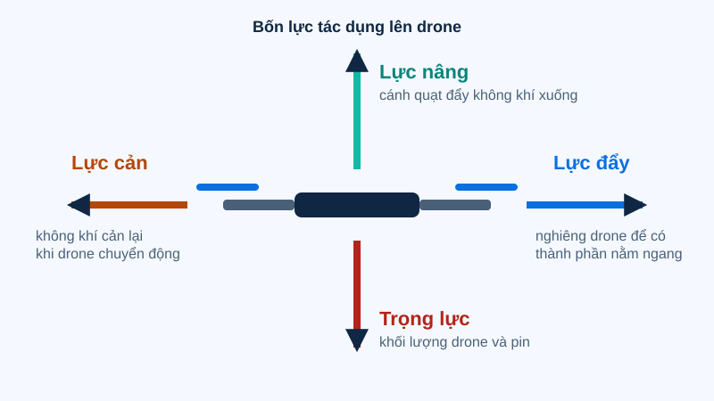
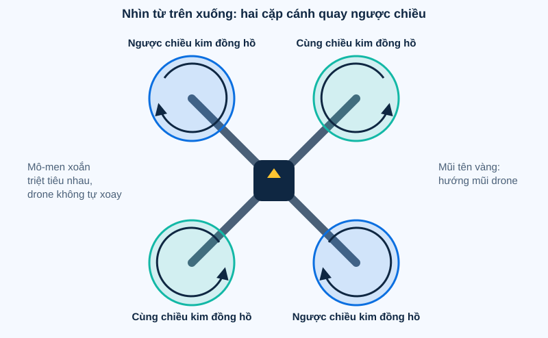

Sau bài này, học sinh giải thích được drone bốn cánh (quadcopter) cất cánh, đứng yên trên không, bay tới và xoay hướng bằng cách nào, chỉ với kiến thức về lực và chuyển động đã học ở môn Vật lý.

## Bốn lực tác dụng lên drone

Giống máy bay, một chiếc drone đang bay luôn chịu bốn lực:

- **Lực nâng:** cánh quạt quay, đẩy không khí xuống dưới. Theo định luật III Newton, không khí đẩy ngược cánh quạt lên trên.
- **Trọng lực:** khối lượng của khung, động cơ, pin và mọi thứ gắn trên drone, nhân với gia tốc trọng trường.
- **Lực đẩy ngang:** drone không có động cơ riêng để tiến. Nó **nghiêng** cả thân, nên lực nâng có thêm một thành phần nằm ngang kéo drone đi.
- **Lực cản:** không khí cản lại khi drone chuyển động, càng bay nhanh càng lớn.

Khi lực nâng **bằng** trọng lực, drone đứng yên trên không (bay treo). Lực nâng lớn hơn thì drone đi lên, nhỏ hơn thì drone đi xuống.

:::note
Người lắp drone thường chọn động cơ và cánh quạt sao cho tổng lực nâng tối đa khoảng gấp đôi trọng lượng. Phần dư đó giúp drone lên nhanh, chống gió và giữ thăng bằng.
:::

## Vì sao cánh quạt quay ngược chiều nhau?

Mỗi cánh quạt khi quay còn tạo ra một **mô-men xoắn** làm thân drone muốn quay ngược lại (giống khi bạn vặn mạnh một chiếc tuốc nơ vít trên mặt bàn trơn). Nếu cả bốn cánh quay cùng chiều, drone sẽ tự xoay tròn.

Vì thế quadcopter dùng **hai cặp** cánh: một cặp chéo nhau quay cùng chiều kim đồng hồ, cặp kia quay ngược chiều. Mô-men xoắn của hai cặp triệt tiêu nhau.

## Điều khiển chỉ bằng tốc độ động cơ

Quadcopter không có cánh lái như máy bay. Mọi chuyển động đều đến từ việc cho bốn động cơ quay nhanh chậm khác nhau:

| Muốn drone | Mạch bay làm gì |
|---|---|
| Lên, xuống | Tăng hoặc giảm tốc **cả bốn** động cơ |
| Tiến tới | Hai động cơ phía sau quay nhanh hơn, drone chúi mũi về trước |
| Sang trái | Hai động cơ bên phải quay nhanh hơn, drone nghiêng sang trái |
| Xoay tại chỗ | Cặp quay cùng chiều kim đồng hồ nhanh hơn cặp kia, mô-men không còn cân bằng nên thân xoay |

Mạch bay điều chỉnh tốc độ động cơ hàng trăm lần mỗi giây. Người điều khiển chỉ ra lệnh "nghiêng trái", còn mạch bay lo phần tính toán. Bài [PID: vì sao drone tự giữ thăng bằng](/r-d/pid-drone-giu-thang-bang) giải thích phần này.

## Hoạt động trên lớp (15 phút)

1. **Dự đoán:** cho học sinh xem drone đứng yên trên không và hỏi: "Lực nào đang cân bằng nhau?"
2. **Thử nghiệm an toàn:** tháo cánh quạt, cầm drone và yêu cầu học sinh quan sát động cơ quay theo chiều nào khi giáo viên đẩy cần ga nhẹ (chỉ giáo viên thao tác).
3. **Tính nhẩm:** drone nặng 300 g cần tổng lực nâng tối thiểu bao nhiêu niutơn để bay treo? (gần 3 N với g ≈ 9,8 m/s²)
4. **Bay thử trên máy:** dùng [trình bay mô phỏng](/bay-mo-phong), bài "Cất cánh và giữ độ cao", để thấy drone lên, xuống khi đổi ga.

:::warning
Không để học sinh cầm drone có lắp cánh quạt khi pin đang cắm. Cánh quạt quay có thể gây đứt tay.
:::

## Gợi ý mở rộng

- **THCS:** vẽ sơ đồ lực cho ba trường hợp: bay treo, đi lên, bay tới.
- **THPT:** phân tích lực nâng thành hai thành phần khi drone nghiêng góc 20°, ước lượng gia tốc theo phương ngang.
- **Câu hỏi thảo luận:** vì sao drone bay kém hơn ở vùng núi cao, nơi không khí loãng?

Muốn đưa drone vào giờ học Vật lý, xem các [giải pháp cho THCS](/giao-duc/thcs) và [THPT](/giao-duc/thpt).

::product{slug=dv-primary-lab}

## Tham khảo

- Wikipedia, mục "Quadcopter": nguyên lý điều khiển bằng chênh lệch tốc độ động cơ.
- Sách giáo khoa Vật lý 10: các định luật Newton, tổng hợp và phân tích lực.

*Ảnh bìa: Josh Sorenson, CC0, Wikimedia Commons. Hình vẽ: Drone Việt.*
