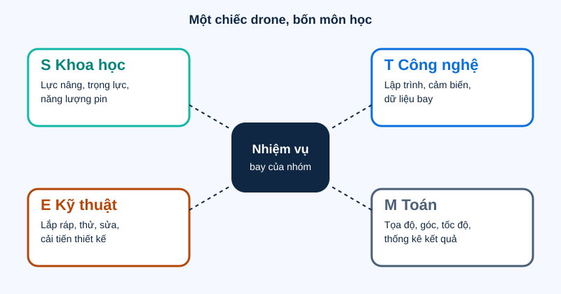

Drone đưa lớp học STEM ra khỏi trang giấy: học sinh tính toán, lập trình, lắp ráp rồi thấy kết quả bay ngay trước mắt, đúng hoặc sai đều rõ ràng. Bài này giải thích vì sao drone hợp với giáo dục STEM, cách tổ chức một dự án theo từng bước và cách đánh giá công bằng.

## Vì sao drone hợp với STEM

- **Một vật thể, bốn môn học.** Cùng một chiếc drone, học sinh gặp lực và năng lượng (Khoa học), lập trình và cảm biến (Công nghệ), lắp ráp và cải tiến (Kỹ thuật), tọa độ và thống kê (Toán).
- **Phản hồi tức thì.** Chương trình sai thì drone bay sai ngay. Học sinh tự phát hiện lỗi mà không cần chờ chấm bài.
- **Có thật ngoài đời.** Drone đang được dùng trong nông nghiệp, bản đồ, cứu hộ ([UAV ngoài đời thực](/r-d/ung-dung-uav-thuc-te)), nên câu hỏi "học cái này để làm gì" có câu trả lời cụ thể.
- **Hợp làm việc nhóm.** Một nhiệm vụ bay cần người lập trình, người quan sát, người ghi dữ liệu và người lo an toàn.

## Tổ chức một dự án STEM theo 6 bước

1. **Đặt câu hỏi.** Bắt đầu từ một vấn đề, không phải từ thiết bị. Ví dụ: "Drone chở thêm vật nặng thì bay được bao lâu?"
2. **Tìm hiểu.** Học sinh đọc tài liệu, xem bài [Drone bay như thế nào](/r-d/drone-bay-nhu-the-nao) và [Cấu tạo drone](/r-d/cau-tao-drone) để có kiến thức nền.
3. **Dự đoán.** Mỗi nhóm viết ra dự đoán và lý do, trước khi bay.
4. **Thí nghiệm.** Thiết kế cách đo: thay đổi một yếu tố, giữ nguyên các yếu tố còn lại, lặp lại ít nhất 3 lần.
5. **Phân tích.** Ghi số liệu vào bảng, vẽ đồ thị, so sánh với dự đoán.
6. **Chia sẻ.** Trình bày kết quả, nói rõ hạn chế và lần sau sẽ làm gì khác.

:::note
Bước 4 là chỗ khác biệt giữa "chơi drone" và "học STEM với drone". Hướng dẫn học sinh ghi chép điều kiện thí nghiệm (pin, gió, khối lượng) ngay từ đầu.
:::

## Gợi ý đề tài theo cấp học

| Cấp | Đề tài | Kiến thức chính |
|---|---|---|
| THCS | Drone chở thêm 10 g, 20 g, 30 g thì thời gian bay thay đổi thế nào? | Đo lường, bảng số liệu, đồ thị |
| THCS | Lập trình drone vẽ đa giác đều, tìm quy luật góc xoay | Hình học, vòng lặp |
| THPT | Đo độ cao bằng áp kế và so với thước dây | Áp suất khí quyển, sai số |
| THPT | Bám theo quả bóng màu bằng camera | Xử lý ảnh, vòng điều khiển |
| Đại học | Chỉnh PID và so sánh log bay với mô phỏng | Lý thuyết điều khiển |
| Đại học | Phát hiện vật thể trên ảnh chụp từ trên cao | Học máy, đánh giá mô hình |

Các đề tài THPT và đại học có hướng dẫn chi tiết trong bài [Cảm biến trên drone](/r-d/cam-bien-tren-drone), [PID](/r-d/pid-drone-giu-thang-bang) và [Thị giác máy tính](/r-d/thi-giac-may-tinh-tren-drone).

## Từ lớp học tới lab nghiên cứu

Ở đại học và lab nghiên cứu, cùng quy trình trên được nâng lên thành **thí nghiệm có thể lặp lại**:

- **Giao thức thí nghiệm** viết trước: điều kiện bay, thiết bị, số lần lặp, cách đo.
- **Ghi log bay** từ mạch bay và lưu kèm mã nguồn, cấu hình, để người khác chạy lại được.
- **Mô phỏng trước, bay thật sau:** thử thuật toán trong môi trường mô phỏng, chỉ đưa lên drone thật khi đã ổn định, giống cách nhiều nhóm nghiên cứu robot làm.
- **Công bố trung thực:** báo cáo cả những lần thất bại và giới hạn của thí nghiệm.

## Đánh giá bằng rubric

| Tiêu chí | Đạt | Tốt | Xuất sắc |
|---|---|---|---|
| Câu hỏi và dự đoán | Có câu hỏi | Dự đoán có lý do | Dự đoán dựa trên kiến thức đã học |
| Thí nghiệm | Bay được nhiệm vụ | Thay đổi một yếu tố, lặp lại | Kiểm soát điều kiện, ghi chép đầy đủ |
| Số liệu | Có bảng số liệu | Có đồ thị | Phân tích sai số, so với dự đoán |
| An toàn | Tuân thủ quy tắc | Chủ động nhắc nhóm | Đề xuất cải tiến quy trình an toàn |
| Trình bày | Nêu được kết quả | Giải thích được vì sao | Nêu hạn chế và hướng làm tiếp |

## Bắt đầu thế nào

- Học sinh tập điều khiển trên [trình bay mô phỏng](/bay-mo-phong) trước buổi bay thật.
- Buổi đầu tiên có thể là một [Workshop trải nghiệm drone](/giao-duc/workshop) có huấn luyện viên đi kèm.
- Xây chương trình cả năm theo khung trong bài [Thiết kế giáo trình drone từ cấp 1 đến đại học](/r-d/giao-trinh-drone-theo-cap-hoc).

::product{slug=dv-code-fleet}

*Ảnh bìa: drone tự hành trong một dự án sinh viên. Mais Jamal, Youshaa Murhij, Zain Alabiden Ali, CC BY-SA 4.0, Wikimedia Commons.*
