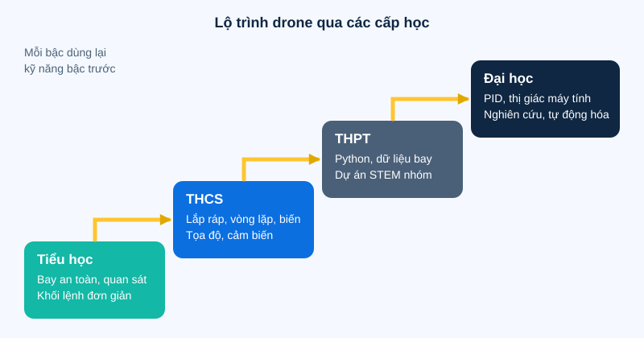

Một giáo trình drone tốt bắt đầu từ năng lực thật của người học, rồi nâng dần độ khó qua từng năm. Bài này đưa ra khung cho bốn cấp học: mục tiêu, hoạt động tiêu biểu, thiết bị, thời lượng và cách đánh giá, để nhà trường xây chương trình liền mạch thay vì những buổi học rời rạc.

## Ba nguyên tắc chung

1. **An toàn trước, bay sau.** Mỗi cấp đều mở đầu bằng quy tắc an toàn phù hợp lứa tuổi, xem [Checklist an toàn bay](/r-d/checklist-an-toan-bay-truong-hoc).
2. **Mỗi bài học có một nhiệm vụ bay.** Học sinh nhớ lâu khi kiến thức dẫn tới việc drone làm được điều gì đó: bay qua cổng, hạ đúng ô, chụp được ảnh.
3. **Bậc sau dùng lại kỹ năng bậc trước.** Vòng lặp học ở THCS trở thành công cụ để xử lý dữ liệu bay ở THPT.

## Tiểu học: làm quen và an toàn

- **Mục tiêu:** hiểu drone bay được nhờ cánh quạt, biết quy tắc an toàn, điều khiển drone nhỏ lên, xuống, tiến, lùi.
- **Hoạt động tiêu biểu:** bay mô phỏng trên máy tính bảng; lập trình khối lệnh "cất cánh, bay tới, hạ cánh"; trò chơi bay qua vòng tròn treo thấp.
- **Thiết bị:** drone dưới 0,25 kg có khung bảo vệ cánh quạt, máy tính bảng.
- **Thời lượng gợi ý:** 6 đến 10 tiết 35 phút, có thể lồng vào giờ hoạt động trải nghiệm.
- **Đánh giá:** quan sát; học sinh nói lại được 3 quy tắc an toàn và hoàn thành một nhiệm vụ bay ngắn.

Xem gợi ý thiết bị tại trang [Tiểu học](/giao-duc/tieu-hoc).

## THCS: lắp ráp và tư duy thuật toán

- **Mục tiêu:** nhận biết bộ phận của drone, dùng vòng lặp, biến, điều kiện để lập trình nhiệm vụ; liên hệ với tọa độ và góc trong môn Toán.
- **Hoạt động tiêu biểu:** tìm hiểu [cấu tạo drone](/r-d/cau-tao-drone); [5 bài tập khối lệnh](/r-d/lap-trinh-drone-khoi-lenh) từ hình vuông đến đa giác bất kỳ; nhiệm vụ giao hàng giữa hai trạm.
- **Thiết bị:** drone lập trình được theo nhóm 3 đến 4 học sinh, bộ linh kiện để quan sát và lắp thử.
- **Thời lượng gợi ý:** 1 tiết mỗi tuần trong một học kỳ.
- **Đánh giá:** chương trình chạy đúng nhiệm vụ, nhóm giải thích được thuật toán, nhật ký nhóm.

Xem trang [THCS](/giao-duc/thcs).

## THPT: dữ liệu và dự án STEM

- **Mục tiêu:** lập trình bằng ngôn ngữ văn bản (thường là Python), thu thập và phân tích dữ liệu bay, làm dự án nhóm có báo cáo.
- **Hoạt động tiêu biểu:** đọc cảm biến IMU và áp kế ([Cảm biến trên drone](/r-d/cam-bien-tren-drone)); mô phỏng PID ([PID](/r-d/pid-drone-giu-thang-bang)); dự án bám theo vật thể màu.
- **Thiết bị:** drone lập trình Python, mô-đun cảm biến rời, máy tính.
- **Thời lượng gợi ý:** chuyên đề 15 đến 20 tiết hoặc câu lạc bộ STEM cả năm.
- **Đánh giá:** báo cáo dự án có số liệu, thuyết trình trước lớp, sản phẩm chạy thật.

Lớp song ngữ và trường quốc tế có thể dùng học liệu tiếng Anh, xem trang [THPT & quốc tế](/giao-duc/thpt).

## Đại học: nghiên cứu và tự động hóa

- **Mục tiêu:** thiết kế thí nghiệm có thể lặp lại, chỉnh điều khiển, ứng dụng thị giác máy tính và học máy, công bố kết quả.
- **Hoạt động tiêu biểu:** ghi log bay và so sánh với mô phỏng; dự án [thị giác máy tính](/r-d/thi-giac-may-tinh-tren-drone); bài toán khảo sát, bản đồ ([UAV ngoài đời thực](/r-d/ung-dung-uav-thuc-te)).
- **Thiết bị:** nền tảng drone mở cho payload cảm biến, máy tính nhúng, môi trường mô phỏng.
- **Thời lượng gợi ý:** học phần 2 đến 3 tín chỉ, hoặc đề tài nghiên cứu sinh viên.
- **Đánh giá:** đề cương thí nghiệm, bộ dữ liệu và mã nguồn công khai trong nhóm, báo cáo theo mẫu khoa học.

Xem trang [Đại học & R&D](/giao-duc/dai-hoc).

## So sánh nhanh bốn cấp

| | Tiểu học | THCS | THPT | Đại học |
|---|---|---|---|---|
| Lập trình | Khối lệnh đơn giản | Khối lệnh có biến, vòng lặp | Python | Python, C++, ROS |
| Kiến thức nền | An toàn, quan sát | Cấu tạo, tọa độ, góc | Cảm biến, dữ liệu | Điều khiển, AI |
| Sản phẩm cuối | Một nhiệm vụ bay | Chương trình + nhật ký | Dự án có báo cáo | Thí nghiệm + bộ dữ liệu |
| Giấy phép điều khiển | Không cần (drone dưới 0,25 kg) | Không cần (drone dưới 0,25 kg) | Tùy drone | Tùy drone |

Quy định về giấy phép theo trọng lượng drone xem tại trang [Chứng chỉ, giấy phép bay](/dao-tao/chung-chi).

## Bắt đầu từ đâu?

1. Chọn một cấp và một học kỳ thử nghiệm, không triển khai toàn trường ngay.
2. Đào tạo 2 đến 3 giáo viên nòng cốt trước; họ sẽ là người hướng dẫn đồng nghiệp.
3. Tổ chức một buổi [Workshop trải nghiệm drone](/giao-duc/workshop) để học sinh và phụ huynh thấy giá trị của chương trình.
4. Sau học kỳ đầu, rút kinh nghiệm rồi mở rộng sang các cấp khác.

Drone Việt cung cấp combo thiết bị, giáo trình theo cấp học và đào tạo giáo viên. [Nhận tư vấn cho trường](/bao-gia).

::product{slug=dv-code-fleet}

*Ảnh bìa: trẻ em quan sát một chiếc drone tại Đại học Bách khoa Bragança, Bồ Đào Nha. Caio.st.oliveira, CC BY-SA 4.0, Wikimedia Commons.*
