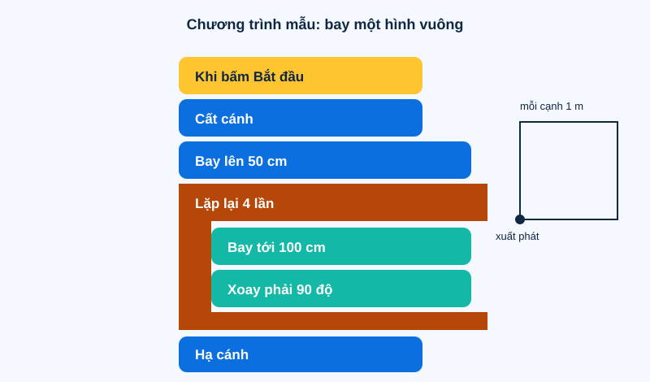

Lập trình drone biến những khái niệm trừu tượng như trình tự, vòng lặp, biến thành chuyển động thấy được ngay trước mắt. Bài này gồm năm bài tập theo thứ tự khó dần, dùng được với các drone giáo dục lập trình bằng khối lệnh.

## Chuẩn bị

- **Drone:** loại nhỏ dưới 0,25 kg, có khung bảo vệ cánh quạt, lập trình được bằng khối lệnh. Ví dụ quen thuộc là dòng Tello EDU, lập trình qua ứng dụng khối lệnh như DroneBlocks hoặc qua Python.
- **Thiết bị lập trình:** máy tính bảng hoặc laptop, mỗi nhóm 3 đến 4 học sinh một drone.
- **Không gian:** phòng học hoặc nhà thể chất, bay trong vùng khoanh dây, mặt sàn có vạch để drone định vị tốt.
- **Thời lượng:** mỗi bài tập 15 đến 20 phút.

:::note
Học sinh dưới 18 tuổi chỉ nên tự điều khiển drone dưới 0,25 kg. Xem quy định tại trang [Chứng chỉ, giấy phép bay](/dao-tao/chung-chi).
:::

## Bài 1: Cất cánh và hạ cánh

**Mục tiêu:** hiểu chương trình chạy **theo thứ tự** từ trên xuống.

Khối lệnh: `Cất cánh` → `Chờ 3 giây` → `Hạ cánh`.

Câu hỏi: nếu đổi chỗ `Hạ cánh` lên trước `Chờ`, drone làm gì?

## Bài 2: Bậc thang

**Mục tiêu:** dùng lệnh có **tham số** (khoảng cách).

Khối lệnh: `Cất cánh` → `Bay tới 50 cm` → `Bay lên 30 cm` → `Bay tới 50 cm` → `Bay lên 30 cm` → `Hạ cánh`.

Thử thách: đo chiều cao thật của drone sau mỗi bậc bằng thước dán trên tường. Drone có lên đúng 30 cm không? Vì sao có sai số?

## Bài 3: Hình vuông với vòng lặp

**Mục tiêu:** nhận ra phần lặp lại và dùng **vòng lặp**.

Trước khi dùng vòng lặp, cho học sinh viết đủ 8 khối `Bay tới` và `Xoay` rồi hỏi: "Có cách nào viết ngắn hơn?"

## Bài 4: Đa giác bất kỳ với biến

**Mục tiêu:** dùng **biến** để một chương trình vẽ được nhiều hình.

Tạo biến `so_canh`. Vòng lặp chạy `so_canh` lần, mỗi lần `Bay tới 80 cm` rồi `Xoay phải (360 / so_canh) độ`.

Thử với 3, 4, 5, 6 cạnh. Học sinh tự phát hiện quan hệ giữa số cạnh và góc xoay, nối với kiến thức hình học.

## Bài 5: Nhiệm vụ giao hàng

**Mục tiêu:** ghép mọi thứ đã học thành một nhiệm vụ có điều kiện thành công.

Đặt hai "trạm" trên sàn cách nhau 2 m. Drone cất cánh ở trạm A, bay tới trạm B, hạ cánh, chờ 3 giây (giả lập giao hàng), cất cánh lại và về trạm A.

Chấm điểm theo:

| Tiêu chí | Điểm |
|---|---|
| Hạ cánh trong vòng tròn bán kính 30 cm ở trạm B | 3 |
| Về đúng trạm A | 3 |
| Chương trình có dùng vòng lặp hoặc biến | 2 |
| Nhóm giải thích được chương trình | 2 |

## Lỗi thường gặp

- **Drone trôi ngang khi bay treo:** sàn quá trơn hoặc thiếu sáng, cảm biến quang học khó nhận mặt sàn. Dán băng keo có hoa văn lên sàn và bật đủ đèn.
- **Lệnh bị bỏ qua:** gửi lệnh mới khi lệnh trước chưa xong. Thêm khối `Chờ` giữa các lệnh.
- **Pin yếu, drone không cất cánh:** luân phiên pin, xem bài [Pin LiPo an toàn trong lớp học](/r-d/pin-lipo-an-toan-lop-hoc).

## Tổ chức tiết học

1. **5 phút:** an toàn và vai trò trong nhóm (lập trình, quan sát, an toàn, ghi chép; đổi vai sau mỗi bài).
2. **10 phút:** viết chương trình trên máy, chưa bay.
3. **15 phút:** bay thử theo lượt, mỗi nhóm một vùng bay.
4. **5 phút:** nhóm trình bày "chương trình chạy đúng chưa, sửa gì".

Học sinh chưa quen điều khiển có thể tập trước trên [trình bay mô phỏng](/bay-mo-phong). Nhà trường muốn tổ chức buổi đầu có huấn luyện viên đi kèm có thể đăng ký [Workshop trải nghiệm drone](/giao-duc/workshop).

::product{slug=dv-primary-lab}

## Tham khảo

- Tài liệu SDK của Tello EDU (Ryze Tech): danh sách lệnh bay qua lập trình.
- Chương trình môn Tin học: tư duy thuật toán, cấu trúc lặp.

*Ảnh bìa: Ryze Tello và Tello EDU. ZLEA, CC BY-SA 4.0, Wikimedia Commons.*
