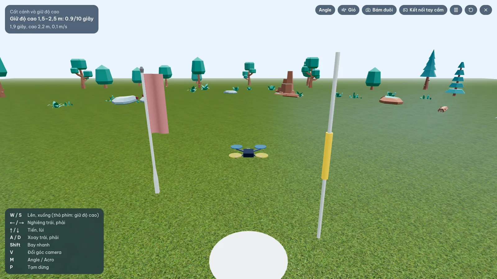
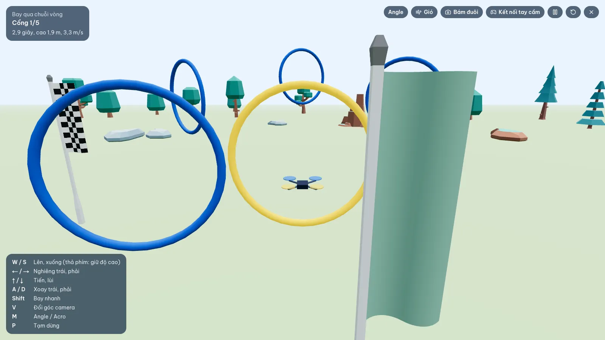
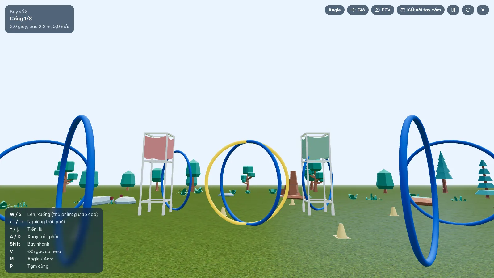

Bay mô phỏng giúp học sinh làm quen tay điều khiển trước khi chạm vào drone thật: không lo pin, không lo rơi vỡ, cả lớp tập cùng lúc. Trình mô phỏng của Drone Việt chạy ngay trên trình duyệt, không cần cài đặt, tại [droneviet.vn/bay-mo-phong](/bay-mo-phong).

## Bốn bài tập theo thứ tự

| Bài | Nhiệm vụ | Kỹ năng luyện |
|---|---|---|
| 1. Cất cánh và giữ độ cao | Giữ drone ở độ cao 1,5 đến 2,5 m đủ 10 giây | Điều chỉnh ga nhẹ tay |
| 2. Hạ cánh vào ô | Bay tới ô vàng và đáp nhẹ vào giữa | Phối hợp tiến, nghiêng, hạ |
| 3. Bay qua chuỗi vòng | Qua 5 vòng đúng thứ tự | Định hướng trong không gian 3 chiều |
| 4. Bay số 8 | Vòng quanh hai cột, qua đủ 8 cổng | Vừa xoay vừa tiến, điều khiển mượt |

Mỗi bài có điểm, số sao và thời gian. Kết quả được lưu trên máy, và lưu vào tài khoản nếu học sinh đăng nhập.

## Phím điều khiển

| Phím | Tác dụng |
|---|---|
| W / S | Lên, xuống. Ở chế độ Angle, thả phím là drone tự giữ độ cao |
| ← / → | Nghiêng trái, phải |
| ↑ / ↓ | Tiến, lùi |
| A / D | Xoay trái, phải |
| Shift | Bay nhanh |
| V | Đổi góc camera |
| M | Đổi chế độ Angle / Acro |
| P | Tạm dừng |

Trình mô phỏng còn dùng được với **tay cầm chơi game hoặc bộ điều khiển RC** cắm qua USB (có màn hình hiệu chỉnh trục) và với **hai cần ảo trên điện thoại, máy tính bảng**.

Ở bài 1, cột có đoạn màu vàng cho biết khoảng độ cao cần giữ. Học sinh nhìn cột để ước lượng độ cao, giống khi bay thật ngoài sân.

## Angle hay Acro?

- **Angle:** thả cần là drone tự trở về nằm ngang và giữ độ cao. Dành cho người mới, giống chế độ mặc định của hầu hết drone giáo dục.
- **Acro:** drone giữ nguyên góc nghiêng khi thả cần, ga cũng giữ nguyên. Khó hơn nhiều, gần với drone đua FPV. Thử ở chế độ này giúp học sinh hiểu vì sao mạch bay phải có vòng tự cân bằng (xem bài [PID](/r-d/pid-drone-giu-thang-bang)).

## Ba góc camera

Nhấn **V** để đổi giữa:

1. **Bám đuôi:** camera theo sau drone, dễ nhất cho người mới.
2. **FPV:** nhìn từ chính drone, như đeo kính FPV.
3. **Mặt đất:** đứng ở chỗ người điều khiển và nhìn lên, đúng như khi bay trong tầm mắt ngoài đời. Đây là góc nên tập kỹ trước khi bay thật.

## Giáo án 45 phút

1. **5 phút:** giới thiệu bốn lực và cách drone di chuyển (bài [Drone bay như thế nào](/r-d/drone-bay-nhu-the-nao)).
2. **10 phút:** từng học sinh làm bài 1 cho tới khi đạt ít nhất 1 sao.
3. **10 phút:** làm bài 2; ai xong sớm chuyển sang bài 3.
4. **10 phút:** đổi sang góc camera **Mặt đất** và làm lại bài 2. Thảo luận: khó hơn ở chỗ nào?
5. **10 phút:** thi đua theo nhóm ở bài 3 hoặc 4, ghi điểm lên bảng. Tổng kết: kỹ năng nào cần khi bay drone thật?

:::note
Trình mô phỏng đơn giản hóa vật lý để dễ học. Drone thật chịu gió, độ trễ và giới hạn pin, nên vẫn cần tập bay thật có hướng dẫn. Nhà trường có thể đăng ký [Workshop trải nghiệm drone](/giao-duc/workshop) cho buổi bay thật đầu tiên.
:::

## Lỗi thường gặp

- **Drone vọt lên quá cao ở bài 1:** nhấn W thật ngắn, chờ drone dừng rồi mới nhấn tiếp.
- **Bay qua vòng bị lệch:** dừng hẳn, xoay mũi về phía vòng (A/D), rồi mới tiến (↑).
- **Máy chạy chậm:** trình mô phỏng tự chuyển sang chế độ nhẹ khi máy yếu; đóng bớt tab khác.

::product{slug=dv-primary-lab}

*Ảnh trong bài: chụp từ trình bay mô phỏng của Drone Việt.*
