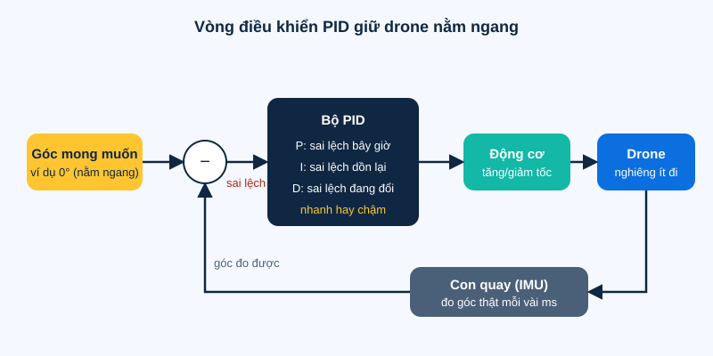

Thả tay khỏi cần điều khiển, drone vẫn nằm ngang dù có gió. Thứ làm việc đó là bộ điều khiển **PID** trong mạch bay. Bài này giải thích PID bằng ví dụ dễ hình dung và cho một đoạn mã Python để thử.

## Ví dụ: tự giữ thăng bằng trên xe đạp

Khi xe nghiêng sang trái, bạn lái sang trái để lấy lại thăng bằng:

- Nghiêng **nhiều** thì lái **mạnh** (P).
- Gió thổi đều từ một phía làm xe cứ lệch mãi, bạn dần nghiêng người bù lại (I).
- Xe đang nghiêng **nhanh** về một bên thì bạn phản ứng sớm, trước khi nó nghiêng hẳn (D).

Mạch bay làm đúng ba việc này, hàng trăm lần mỗi giây, cho từng trục: nghiêng trái phải (roll), chúc ngóc (pitch) và xoay (yaw).

## Vòng điều khiển



1. **Sai lệch** = góc mong muốn − góc đo được (từ con quay và gia tốc kế).
2. **Bộ PID** tính lệnh: `P × sai lệch + I × tổng sai lệch + D × tốc độ thay đổi của sai lệch`.
3. Lệnh được cộng vào tốc độ các động cơ, drone đổi góc, cảm biến đo lại, và vòng lặp tiếp tục.

## Ý nghĩa từng thành phần

| Thành phần | Làm gì | Quá lớn thì | Quá nhỏ thì |
|---|---|---|---|
| **P** (tỉ lệ) | Đẩy về đích mạnh khi lệch nhiều | Rung, dao động quanh điểm cân bằng | Phản ứng ì, bị gió đẩy lệch |
| **I** (tích phân) | Bù sai lệch kéo dài, như gió đều hay trọng tâm lệch | Vọt lố chậm, lắc lư lớn | Drone cứ trôi về một phía |
| **D** (vi phân) | Hãm lại khi đang tiến về đích nhanh | Động cơ nóng, nhạy với nhiễu cảm biến | Vọt quá đích rồi mới quay lại |

## Thử trên máy: mô phỏng một trục

Đoạn mã dưới mô phỏng một trục nghiêng của drone (mô hình rất đơn giản, đủ để thấy tác dụng của P, I, D). Chạy bằng Python 3, không cần thư viện ngoài.

```python
# Mô phỏng một trục nghiêng: góc ban đầu 20 độ, muốn đưa về 0 độ.
KP, KI, KD = 4.0, 2.0, 1.2   # thử đổi các số này
dt = 0.01                     # 10 ms mỗi bước
goc, toc_do_goc = 20.0, 0.0   # độ, độ/giây
tong_sai_lech, sai_lech_cu = 0.0, 0.0
gio = 3.0                     # nhiễu đều (độ/giây²), giống gió thổi một phía

for buoc in range(301):
    sai_lech = 0.0 - goc
    tong_sai_lech += sai_lech * dt
    dao_ham = (sai_lech - sai_lech_cu) / dt
    lenh = KP * sai_lech + KI * tong_sai_lech + KD * dao_ham
    sai_lech_cu = sai_lech
    # Mô hình đơn giản: lệnh tạo gia tốc góc, cộng nhiễu gió
    toc_do_goc += (lenh + gio) * dt * 10
    goc += toc_do_goc * dt
    if buoc % 50 == 0:
        print(f"t={buoc * dt:4.1f}s  góc={goc:6.2f}°")
```

Gợi ý thí nghiệm:

1. Đặt `KI = 0`: góc đứng yên ở khoảng 0,75° chứ không về 0, vì gió cứ đẩy đều. Bật lại I: góc nhích dần về 0.
2. Đặt `KD = 0`: góc lắc qua lại quanh 0 và lắc **càng lúc càng mạnh**. Không có D để hãm, hệ mất ổn định.
3. Tăng `KP` lên 20: góc về gần 0 nhanh hơn. Trên drone thật, P quá lớn lại gây rung vì động cơ và cảm biến có độ trễ; mô hình này bỏ qua độ trễ nên chưa thấy rung. Thử thêm độ trễ vào mô hình là một bài tập hay cho sinh viên.
4. Vẽ đồ thị góc theo thời gian (dùng thư viện matplotlib nếu có) và so sánh các bộ số.

:::note
Mô hình trên chỉ để học khái niệm. Drone thật có quán tính, độ trễ động cơ, nhiễu cảm biến; các bộ số P, I, D của drone thật được chỉnh bằng bay thử và bằng công cụ của phần mềm mạch bay.
:::

## Chỉnh PID trên drone thật, theo thứ tự

1. Bắt đầu từ bộ số mặc định của phần mềm mạch bay.
2. Chỉnh **P** trước cho tới khi drone phản ứng nhanh mà chưa rung.
3. Thêm **D** để giảm vọt lố.
4. Cuối cùng chỉnh **I** để drone không trôi theo thời gian.
5. Mỗi lần đổi một số, ghi lại kết quả bay thử.

:::warning
Bay thử khi chỉnh PID chỉ ở khu vực khoanh vùng, có khung bảo vệ cánh quạt, người xem đứng ngoài vùng an toàn.
:::

## Dự án mở rộng

- **THPT:** mô phỏng ba bộ số, vẽ đồ thị, viết báo cáo một trang "bộ số nào tốt nhất và vì sao".
- **Đại học:** ghi dữ liệu bay (log) từ mạch bay, so sánh đáp ứng thực tế với mô phỏng, thử các phương pháp chỉnh tự động.

Trình [bay mô phỏng](/bay-mo-phong) của Drone Việt có chế độ Angle (tự cân bằng) và Acro (giữ nguyên góc), giúp học sinh cảm nhận sự khác nhau khi có và không có vòng tự cân bằng.

::product{slug=dv-research-platform}

## Tham khảo

- Wikipedia, mục "PID controller".
- Tài liệu Betaflight và PX4 về chỉnh PID (PID tuning).

*Ảnh bìa: drone tự hành trong một dự án sinh viên. Mais Jamal, Youshaa Murhij, Zain Alabiden Ali, CC BY-SA 4.0, Wikimedia Commons.*
