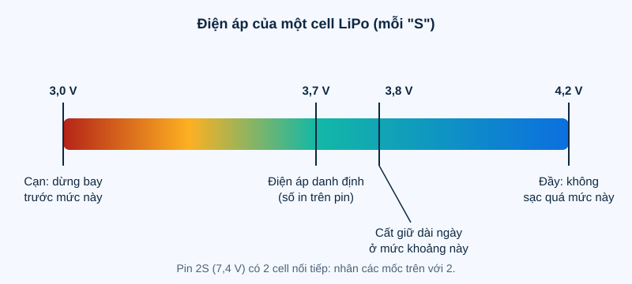

Pin lithium polymer (LiPo) giúp drone nhẹ và bay khỏe, nhưng cũng là bộ phận cần cẩn thận nhất trong lớp học. Bài này là quy trình gọn cho giáo viên và phụ trách phòng thí nghiệm.

## Đọc thông số trên pin

Một viên pin ghi `2S 1.000 mAh 7,4 V 25C` nghĩa là:

- **2S:** hai cell nối tiếp. Mỗi cell danh định 3,7 V nên pin là 7,4 V.
- **1.000 mAh:** dung lượng. Pin xả 1 A trong khoảng một giờ thì hết.
- **25C:** dòng xả tối đa bằng 25 lần dung lượng, tức 25 A với pin 1.000 mAh.

## Sạc pin

1. Chỉ dùng **bộ sạc cân bằng** dành cho LiPo, cắm cả dây cân bằng (đầu cắm nhỏ nhiều dây).
2. Chọn đúng loại pin (LiPo) và đúng số cell trên bộ sạc.
3. Dòng sạc mặc định là **1C** (1 A cho pin 1.000 mAh) trừ khi nhà sản xuất cho phép cao hơn.
4. Sạc trong **túi chống cháy** hoặc hộp kim loại, đặt trên bề mặt không cháy, xa giấy và vải.
5. **Luôn có người trông.** Không sạc qua đêm, không sạc khi lớp vắng người.
6. Pin vừa bay xong còn nóng: để nguội rồi mới sạc.

## Cất giữ

- Không dùng trong vài ngày thì đưa pin về **mức cất giữ**, khoảng 3,8 V mỗi cell. Nhiều bộ sạc có chế độ "Storage".
- Cất trong túi chống cháy, nơi khô và mát, tránh nắng trong xe hay cạnh cửa kính.
- Bọc đầu cắm để hai cực không chạm vào vật kim loại.

## Khi bay

- Hạ cánh khi điện áp xuống khoảng **3,5 V mỗi cell** dưới tải; đừng bay tới khi drone tự rơi. Xả quá sâu làm pin hỏng nhanh.
- Bay vài phút rồi nghỉ: lịch bay của một lớp nên có đủ pin để luân phiên, không ép một viên pin bay liên tục.

## Dấu hiệu pin phải bỏ

| Dấu hiệu | Làm gì |
|---|---|
| Pin **phồng**, mềm như gối | Ngừng dùng ngay, không sạc |
| Vỏ rách, móp, dây hở | Ngừng dùng, bọc lại |
| Nóng bất thường khi sạc | Rút sạc, chuyển ra chỗ an toàn |
| Một cell lệch nhiều so với các cell khác | Ngừng dùng cho bay |

:::warning
Không chọc thủng, không cắt, không bỏ pin LiPo vào thùng rác thường. Pin hỏng có thể bốc cháy.
:::

**Bỏ pin:** xả pin về mức thấp bằng bộ sạc có chế độ xả (hoặc theo hướng dẫn của nhà sản xuất), dán băng dính cách điện hai đầu cực, mang tới điểm thu gom pin của địa phương hoặc cửa hàng điện tử có nhận thu hồi.

## Nếu pin cháy

- Giữ bình tĩnh, cho học sinh ra xa, không hít khói.
- Nếu an toàn, dùng bình chữa cháy hoặc phủ cát lên pin; để pin cháy hết trên nền không cháy.
- Báo người phụ trách an toàn của trường.

## Quy trình gợi ý cho phòng drone

1. Mỗi viên pin có **số hiệu** và sổ ghi lần sạc, lần bay, tình trạng.
2. Chỉ giáo viên hoặc học sinh đã được hướng dẫn mới sạc pin.
3. Cuối buổi: đếm pin, đưa về mức cất giữ, cất vào hộp chống cháy có khóa.

Xem thêm [Checklist an toàn bay trong trường học](/r-d/checklist-an-toan-bay-truong-hoc).

::product{slug=dv-instructor-kit}

## Tham khảo

- Hướng dẫn an toàn đi kèm bộ sạc và pin của nhà sản xuất (ưu tiên hơn mọi hướng dẫn chung).
- Wikipedia, mục "Lithium polymer battery".

*Ảnh bìa: Daniel van den Ouden, CC BY 2.0, Wikimedia Commons.*
