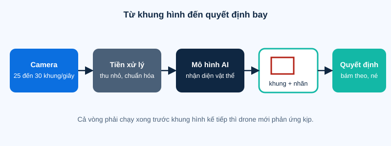
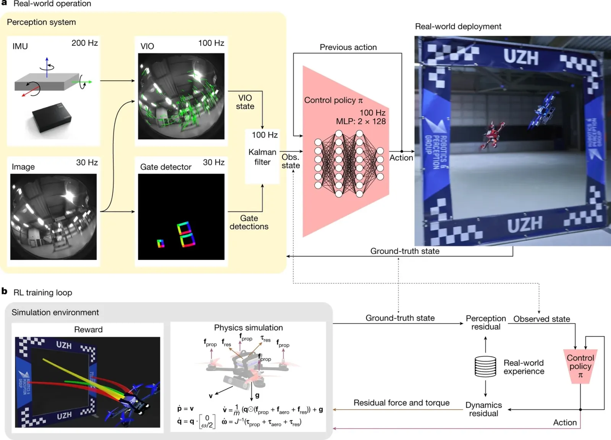

Camera biến drone thành một "con mắt bay". Khi thêm trí tuệ nhân tạo, drone có thể tự nhận ra vật thể, bám theo một người hay bay qua cổng mà không cần người lái. Bài này giải thích quy trình đó và gợi ý dự án vừa sức học sinh, sinh viên.

## Từ khung hình đến quyết định

1. **Camera** chụp khung hình, thường 25 đến 30 khung mỗi giây.
2. **Tiền xử lý:** thu nhỏ ảnh, chuẩn hóa màu để mô hình chạy nhanh.
3. **Mô hình AI** (thường là mạng nơ-ron tích chập) tìm vật thể và trả về khung bao, nhãn và độ tin cậy.
4. **Quyết định:** từ vị trí khung bao trong ảnh, chương trình tính lệnh bay. Ví dụ: vật thể lệch sang phải thì xoay phải.

Cả vòng này phải chạy xong trước khung hình kế tiếp. Vì vậy **độ trễ** quan trọng ngang độ chính xác.

## Xử lý ở đâu?

| Cách | Ưu điểm | Nhược điểm |
|---|---|---|
| Gửi hình về máy tính | Máy mạnh, dễ lập trình bằng Python | Trễ do truyền sóng, phụ thuộc kết nối |
| Máy tính nhúng trên drone | Phản ứng nhanh, bay xa được | Nặng thêm, tốn pin, phải tối ưu mô hình |

Với lớp học, cách thứ nhất dễ bắt đầu: drone nhỏ truyền hình qua Wi-Fi, máy tính chạy mô hình và gửi lệnh bay lại.

## AI đã bay giỏi tới đâu?

Năm 2023, nhóm nghiên cứu ở Đại học Zürich công bố trên tạp chí Nature hệ thống **Swift**: một drone đua tự lái chỉ dùng camera và IMU, được huấn luyện trong mô phỏng bằng học tăng cường, đã thắng các nhà vô địch đua drone trong một số lượt đua.

*Hình: Kaufmann và cộng sự, Nature (2023), CC BY 4.0, Wikimedia Commons.*

Điều đáng học từ kết quả này: **huấn luyện trong mô phỏng rồi chuyển sang drone thật** đã trở thành phương pháp nghiên cứu chính thống. Học sinh có thể bắt đầu bằng mô phỏng trước, giống cách nhóm Swift làm.

## Giới hạn cần nói thật với học sinh

- **Ánh sáng:** mô hình huấn luyện ban ngày có thể nhận sai lúc trời tối hoặc ngược sáng.
- **Rung và mờ:** chuyển động nhanh làm ảnh nhòe, mô hình bỏ sót vật thể.
- **Dữ liệu:** mô hình chỉ giỏi với những gì nó đã thấy. Bộ dữ liệu ít, một màu, một bối cảnh sẽ cho kết quả kém ngoài thực tế.
- **Quyền riêng tư:** quay phim người khác cần sự đồng ý. Dự án ở trường nên dùng đồ vật, biển báo tự làm, hoặc ảnh của chính nhóm khi cả nhóm đồng ý.

## Gợi ý dự án

1. **Bám theo quả bóng màu (THPT):** dùng lọc màu (không cần AI) để tìm quả bóng đỏ, tính độ lệch khỏi tâm ảnh và xoay drone theo. Dự án nhập môn tuyệt vời về vòng điều khiển.
2. **Nhận diện biển báo tự làm (THPT):** in 3 đến 4 biển "rẽ trái", "rẽ phải", "hạ cánh". Chụp ảnh, huấn luyện mô hình phân loại nhỏ, cho drone làm theo biển.
3. **Đếm vật thể trên ảnh chụp từ trên cao (đại học):** gán nhãn ảnh, huấn luyện mô hình phát hiện vật thể, đánh giá bằng độ chính xác và độ phủ (precision, recall).
4. **Bay qua cổng trong mô phỏng (đại học):** huấn luyện chính sách điều khiển trong môi trường mô phỏng, rồi thử trên drone thật ở vùng bay khoanh vùng.

:::warning
Drone chạy chương trình tự động phải có người giám sát cầm sẵn điều khiển, sẵn sàng tắt chương trình và hạ cánh. Bay tự động ngoài trời cần xin phép như mọi chuyến bay khác, xem trang [Cấp phép bay](/dao-tao/cap-phep).
:::

Nền tảng về cảm biến xem trong bài [Cảm biến trên drone](/r-d/cam-bien-tren-drone); vòng điều khiển xem bài [PID](/r-d/pid-drone-giu-thang-bang).

::product{slug=dv-ai-vision}

## Tham khảo

- E. Kaufmann, L. Bauersfeld, A. Loquercio, M. Müller, V. Koltun, D. Scaramuzza. "Champion-level drone racing using deep reinforcement learning". Nature 620 (2023).
- Wikipedia: "Object detection", "Convolutional neural network".

*Ảnh bìa: drone mang LiDAR. Jonte, CC BY-SA 4.0, Wikimedia Commons.*
