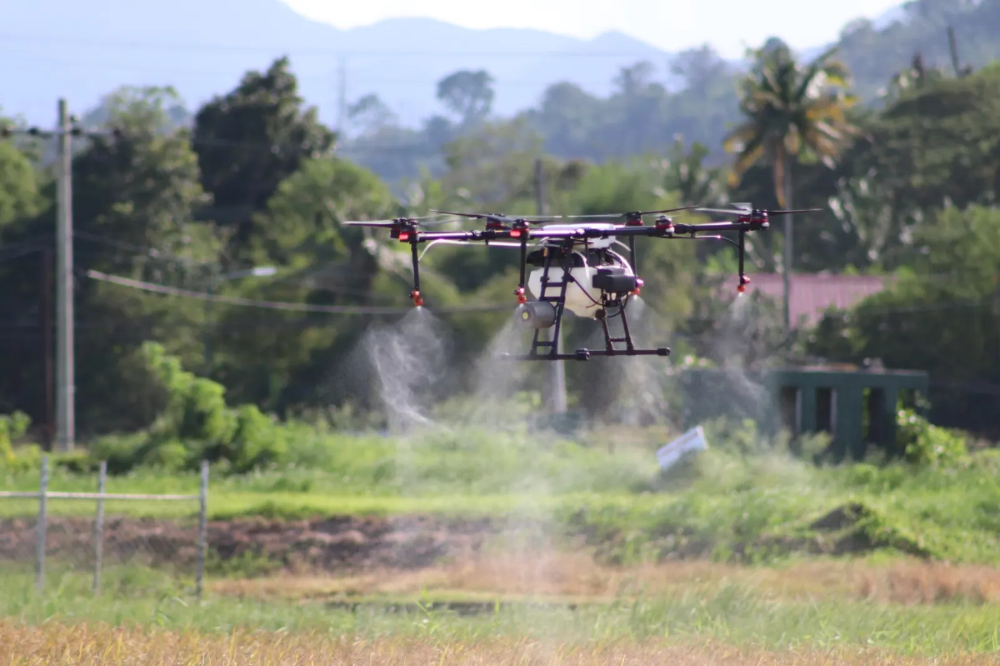
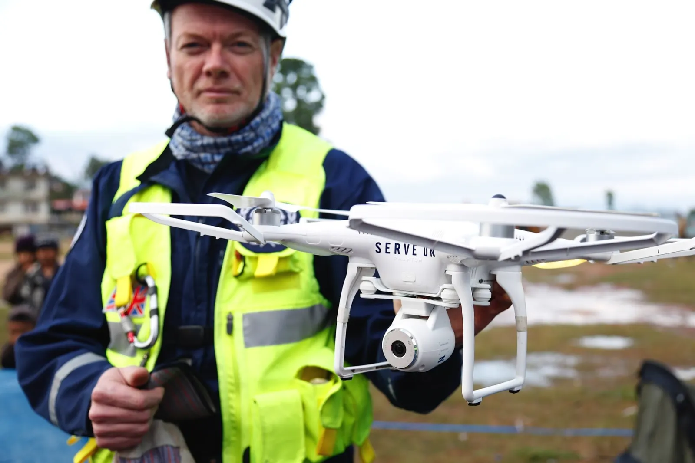

UAV (Unmanned Aerial Vehicle, phương tiện bay không người lái) không chỉ để quay phim. Bài này điểm qua những công việc drone đang làm ngoài đời và gợi ý cách đưa mỗi ứng dụng vào lớp học thành một bài học STEM có thật.

## Nông nghiệp: phun thuốc, bón phân, theo dõi đồng ruộng

Ở các vùng trồng lúa, trong đó có đồng bằng sông Cửu Long, drone phun thuốc và bón phân ngày càng phổ biến. Lợi ích chính: nông dân không phải lội ruộng tiếp xúc trực tiếp với hóa chất, và drone đi theo đường bay lập trình sẵn nên phun đều hơn. Drone gắn camera đa phổ còn chụp được "sức khỏe" cây trồng mà mắt thường chưa thấy.

**Bài học STEM:**
- **Toán:** tính diện tích một thửa ruộng, chiều rộng dải phun, số lượt bay cần thiết.
- **Sinh học, Hóa học:** vì sao lá khỏe phản xạ ánh sáng hồng ngoại gần khác lá bệnh.

*Ảnh: Christopher Hedreyd, PIA 4A CALABARZON, phạm vi công cộng, Wikimedia Commons.*

## Lập bản đồ và khảo sát

Drone bay theo các làn song song, chụp hàng trăm ảnh chồng lên nhau. Phần mềm ghép ảnh (photogrammetry, đo ảnh) tạo ra bản đồ ảnh chi tiết và mô hình 3 chiều của địa hình, công trình. Drone mang LiDAR còn đo được mặt đất dưới tán cây.

**Bài học STEM:**
- **Tin học, Địa lý:** chụp 20 đến 30 ảnh chồng lên nhau quanh một vật (bằng điện thoại cũng được), dựng mô hình 3 chiều bằng phần mềm miễn phí.
- **Toán:** độ chồng ảnh 70% thì hai ảnh liên tiếp cách nhau bao xa khi biết góc nhìn camera và độ cao?

## Tìm kiếm cứu nạn và ứng phó thiên tai

*Ảnh: DFID, Bộ Phát triển Quốc tế Anh, CC BY 2.0, Wikimedia Commons.*

Sau thiên tai, drone giúp đánh giá thiệt hại nhanh ở nơi đường bị chia cắt. Camera nhiệt giúp tìm người vào ban đêm hoặc dưới tán rừng. Drone cũng dùng để kiểm tra đê, cầu, đường dây điện mà người khó tiếp cận.

**Bài học STEM:**
- **Vật lý:** vì sao camera nhiệt "nhìn" được người trong bóng tối (bức xạ hồng ngoại).
- **Kỹ năng sống:** bài tập nhóm lập kế hoạch tìm một "nạn nhân" (một đồ vật) trên sân trường bằng drone, chia vùng tìm kiếm thành ô lưới.

## Vận chuyển hàng hóa và y tế

Ở một số nước, drone đã chở máu, thuốc, mẫu xét nghiệm tới vùng xa. Ví dụ được nhắc nhiều là công ty Zipline chở máu cho bệnh viện ở Rwanda. Bài toán đặt ra: tải trọng, tầm bay, thời tiết, và an toàn cho người dưới mặt đất.

**Bài học STEM:** thiết kế "nhiệm vụ giao hàng" trong lớp như bài 5 của [Lập trình drone bằng khối lệnh](/r-d/lap-trinh-drone-khoi-lenh), rồi thảo luận: nếu hàng nặng gấp đôi thì phải đổi gì ở drone?

## Từ ứng dụng tới nghề nghiệp

| Ứng dụng | Kiến thức nền | Nghề liên quan |
|---|---|---|
| Nông nghiệp | Sinh học, hóa học, cảm biến | Kỹ sư nông nghiệp công nghệ cao, điều khiển drone nông nghiệp |
| Bản đồ, khảo sát | Địa lý, hình học, xử lý ảnh | Trắc địa, GIS, xây dựng |
| Cứu hộ, kiểm tra | Vật lý (nhiệt, quang), an toàn | Cứu hộ, kiểm định công trình, điện lực |
| Vận chuyển | Cơ học, tối ưu đường đi | Hậu cần, kỹ sư hệ thống bay |

:::note
Mọi ứng dụng ngoài trời ở trên đều cần tuân thủ quy định về giấy phép điều khiển, đăng ký drone và xin phép bay. Xem trang [Quy định pháp lý](/dao-tao/quy-dinh) và [Cấp phép bay](/dao-tao/cap-phep).
:::

::product{slug=dv-ai-vision}

## Tham khảo

- Wikipedia: "Agricultural drone", "Photogrammetry", "Zipline (drone delivery company)".
- Viện Nghiên cứu Lúa Quốc tế (IRRI): các tài liệu về ứng dụng drone trong canh tác lúa.

*Ảnh bìa: Christopher Hedreyd, PIA 4A CALABARZON, phạm vi công cộng, Wikimedia Commons.*
